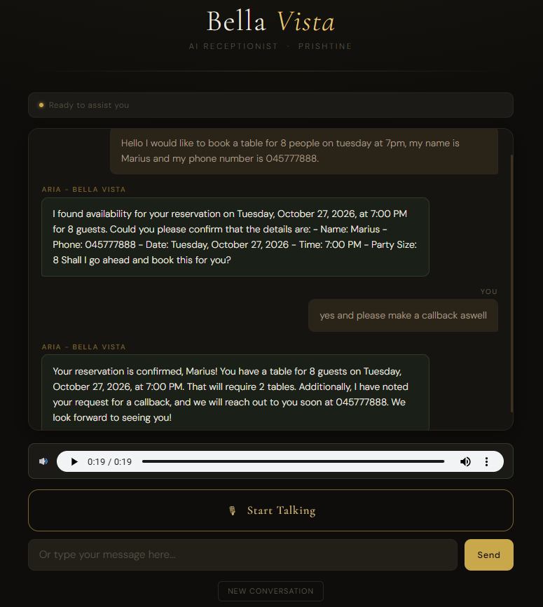
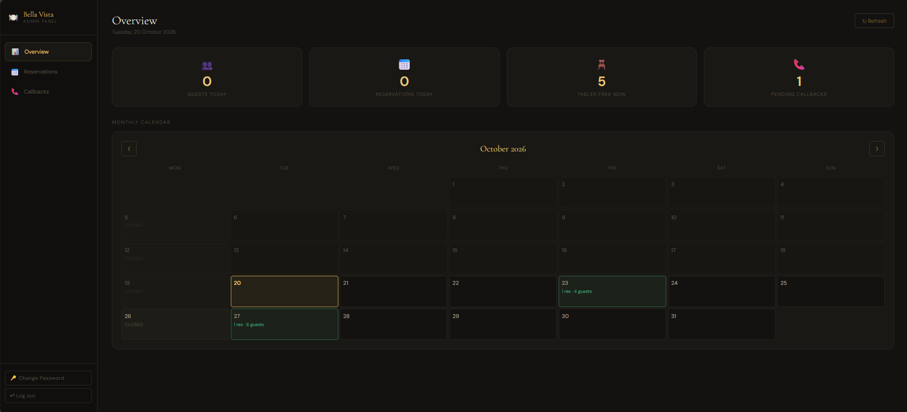
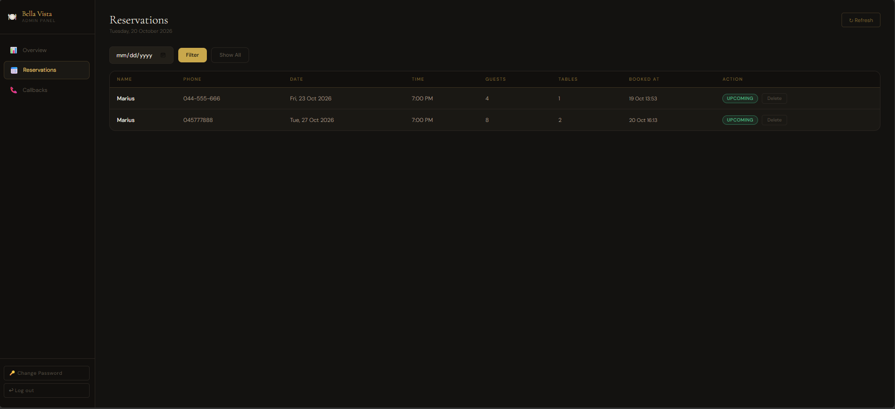
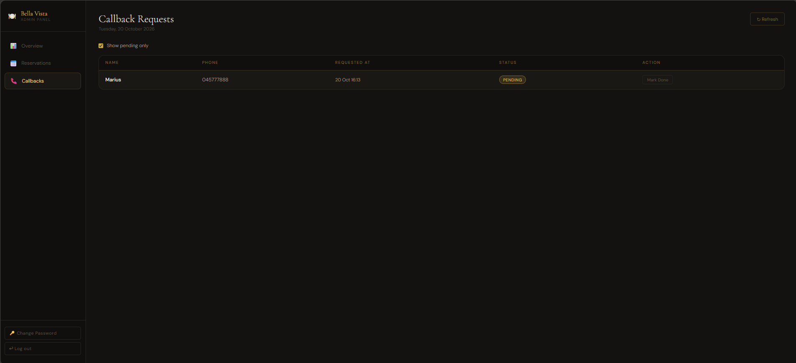

# Voxa – AI Voice Receptionist

Voxa is a voice and text AI receptionist for restaurants. Guests talk (or type) to "Aria" to ask about hours, the menu and location, book a table, or request a callback. Staff manage everything from an admin dashboard. The demo is set up for a fictional restaurant, Bella Vista in Prishtina.

Built as our final-year capstone project by Marius Madan, Erbin Fejzullahu and Rrezon Koshi.

**Live demo:** https://bella-vista-ai-receptionist-fronten.vercel.app
**Admin panel:** https://bella-vista-ai-receptionist-fronten.vercel.app/admin.html (demo password: `admin23`)
**Demo video:** https://youtu.be/HvnJ0P43aMw

> The backend runs on a free hosting tier and goes to sleep when idle. If the first message takes 30–60 seconds, that's the server waking up. After that it's fast. The admin panel is a public demo, so please don't enter real personal data.

## Screenshots

| Voice and text chat | Admin overview |
|---|---|
|  |  |
| **Reservations** | **Callback requests** |
|  |  |

---

## What it does

**For guests**
- Talk or type. Voice is transcribed with Whisper, and answers are read back with text-to-speech.
- Works in English and Albanian (Aria replies in whichever language the guest uses).
- Answers questions about hours, location, parking, services and menu highlights.
- Books tables step by step: name, phone, date, time, party size.
- Checks real availability and opening hours before booking. If a slot is full, it suggests the nearest free times.
- Takes callback requests (name + phone).

**For staff (admin dashboard)**
- Password-protected login (tokens expire after 8 hours).
- Overview with today's guests, reservations, free tables and pending callbacks, plus a monthly calendar.
- Reservations table with date filter and delete.
- Callbacks list with "mark as done".
- Change password from the UI (stored as a salted hash).

## Tech stack

| Layer | Tech |
|---|---|
| Backend | Python, FastAPI, Uvicorn |
| AI | OpenAI `gpt-4o-mini` with function calling, `whisper-1` (speech-to-text), `tts-1` (text-to-speech) |
| Database | Supabase (Postgres), with an in-memory fallback for local demos |
| Frontend | Vanilla HTML / CSS / JavaScript (MediaRecorder API for the mic) |
| Tests | pytest |
| Hosting | Render (backend), Vercel (frontend) |

## How it works

```
Browser ──audio──► /speech-to-text ──► Whisper ──► text
Browser ──text───► /chat ──► gpt-4o-mini ◄──► tools (check_availability, create_reservation, ...)
                                │                          │
                                ▼                          ▼
                           reply text                  Supabase
Browser ◄──audio── /text-to-speech ◄── reply text
```

The model doesn't invent availability. It has to call tools (`get_business_info`, `check_availability`, `create_reservation`, `create_callback_request`), and the Python code decides what's actually bookable:

- 5 tables of 4 seats, 1-hour bookings. A party of 5–8 takes 2 tables, and overlapping reservations count against the total.
- Bookings must be in the future, on an open day, and finish before closing time.
- The restaurant's clock is its own timezone (default `Europe/Belgrade`, same as Kosovo), not the server's, so "today" and "is this in the past?" are right even when the server runs in UTC.

---

## Run it locally

### Requirements
- Python 3.10+
- An [OpenAI API key](https://platform.openai.com/api-keys) with some credit (chat, speech-to-text and text-to-speech all use it)
- Supabase is **optional**. Without it, data is kept in memory.

### 1. Install

```bash
git clone https://github.com/Marius2308/bella-vista-ai-receptionist.git
cd bella-vista-ai-receptionist

python -m venv venv

# Windows (PowerShell)
.\venv\Scripts\Activate.ps1
# macOS / Linux
source venv/bin/activate

pip install -r requirements.txt
```

### 2. Add your keys

Copy `.env.example` to `.env` in the **project root** (next to `requirements.txt`, not inside `backend/`) and fill it in. The minimum is:

```
OPENAI_API_KEY=sk-...
```

| Variable | Required | Notes |
|---|---|---|
| `OPENAI_API_KEY` | Yes | |
| `SUPABASE_URL`, `SUPABASE_KEY` | No | Set both to use Supabase. Leave them out for in-memory storage (data is lost on restart). The key stays on the server only; never put it in the frontend. |
| `ADMIN_PASSWORD` | Recommended | Admin login password. If unset, a random temporary password is generated and printed in the server console on startup. Once you change the password from the dashboard, the (hashed) value in the database takes over and this variable is ignored. |
| `ALLOWED_ORIGINS` | In production | Comma-separated frontend origins allowed to call the API. Defaults to `*`. |
| `RESTAURANT_TIMEZONE` | No | Defaults to `Europe/Belgrade`. |
| `CHAT_MODEL`, `STT_MODEL`, `TTS_MODEL` | No | OpenAI models. Defaults: `gpt-4o-mini`, `whisper-1`, `tts-1`. OpenAI is retiring `whisper-1` on 2027-02-26, so set `STT_MODEL=gpt-transcribe` before then. |
| `AI_RATE_LIMIT_PER_MINUTE` | No | Per-IP limit on chat / voice endpoints. Default 30. |
| `AI_GLOBAL_LIMIT_PER_HOUR` | No | Total limit across all visitors, to cap OpenAI spend. Default 600. |
| `LOGIN_RATE_LIMIT_PER_MINUTE` | No | Per-IP limit on admin login attempts. Default 10. |

### 3. Database setup (only if using Supabase)

Run `backend/schema.sql` in the Supabase SQL editor (if it asks, choose to enable Row Level Security; the script enables it with no policies, so the public keys can't read or write these tables). Use the project's **secret key** (`sb_secret_...`, or the older `service_role` key) as `SUPABASE_KEY`. It bypasses Row Level Security, so it must only ever live on the server, never in the frontend or the repo.

### 4. Start the backend

```bash
cd backend
uvicorn main:app --reload --port 8001
```

You should see `[STARTUP] API key loaded: YES`. Check `http://localhost:8001/health`. Interactive API docs are at `http://localhost:8001/docs`.

### 5. Start the frontend

In a second terminal:

```bash
cd frontend
python -m http.server 5500
```

Open **http://localhost:5500** (chat) and **http://localhost:5500/admin.html** (admin).

Use `localhost`, and don't open `index.html` by double-clicking it. `frontend/config.js` only points at the local backend when the page is served from `localhost`. Browsers also only allow the microphone on `localhost` or HTTPS.

### Things to try

- "What time do you open on Saturday?"
- "I'd like a table for 4 this Friday at 7pm" (it will ask for your name and phone)
- Ask for a Monday (closed) or a time in the past and watch it say no
- Fill a time slot, then ask for it again and watch it suggest alternatives
- "A keni parking?" (Albanian)
- "Can someone call me back?"

Then log in to the admin panel and see the bookings appear.

### Run the tests

```bash
pip install -r requirements-dev.txt
cd backend
pytest
```

The tests use in-memory storage and mocked OpenAI calls, so they cost nothing and never touch a real database, even if you have a `.env`. They cover booking rules, availability maths, conversation-history handling, password hashing, rate limiting and the admin API.

### Troubleshooting

| Problem | Fix |
|---|---|
| `Activate.ps1 cannot be loaded because running scripts is disabled` | Run `Set-ExecutionPolicy -Scope CurrentUser -ExecutionPolicy RemoteSigned`, then try again |
| `uvicorn` is not recognized | The venv isn't active. Activate it, or run `python -m uvicorn main:app --reload --port 8001` using the venv's Python |
| `API key loaded: NO` | The file must be named exactly `.env` (Notepad likes to save `.env.txt`) and sit in the project root |
| Backend crashes on startup with a Supabase error | Check `SUPABASE_URL` / `SUPABASE_KEY` (the key must be the *secret* key, not the publishable one), or remove both to use in-memory storage |
| Chat page can't reach the backend | Make sure you opened it via `http://localhost:5500`, not as a file, and that the backend is running on port 8001 |
| Forgot the admin password | Check the server console: if `ADMIN_PASSWORD` isn't set, a temporary one is printed on startup |

---

## Deployment

**Backend → Render**
1. New → Blueprint, pick this repo. `render.yaml` defines the web service.
2. Set the environment variables in the Render dashboard: `OPENAI_API_KEY`, `SUPABASE_URL`, `SUPABASE_KEY`, `ADMIN_PASSWORD`, and `ALLOWED_ORIGINS` (your Vercel URL, set after step below).
3. Note the service URL (`https://<name>.onrender.com`).

**Frontend → Vercel**
1. Import the repo. Set **Root Directory** to `frontend`, **Framework Preset** to `Other`, and leave the build command empty. It's a plain static site.
2. Before deploying, set `PROD_API_BASE` in `frontend/config.js` to your Render URL.
3. Go back to Render and set `ALLOWED_ORIGINS` to the Vercel URL.

**Keep it alive.** Free Supabase projects are paused after about a week without activity, and the Render free tier sleeps when idle. Set up a free scheduler (for example UptimeRobot or cron-job.org) to call `https://<your-render-url>/health/db` once a day. It's a cheap database read, so it keeps the database awake and wakes the backend. Also open the live demo yourself before sending an application.

The backend keeps chat sessions and admin tokens in memory, so it's meant to run as a single long-lived process (like Render's web service), not as serverless functions. On Render's free tier the service sleeps after about 15 minutes idle and can restart at any time; bookings are safe in Supabase, but chat sessions reset and the admin has to log in again.

## Security notes

- Everything a guest types (names, phone numbers) is escaped before it is shown in the admin dashboard.
- Admin passwords are stored as salted PBKDF2 hashes; login attempts and the paid AI endpoints are rate limited; admin tokens expire after 8 hours.
- Input sizes are capped (message length, audio size) and the tool-calling loop is bounded, to keep OpenAI costs predictable. Set a monthly spend limit in your OpenAI account as well.
- Secrets live in `.env` (git-ignored) and never in the frontend.

## API overview

| Method | Path | Auth | Purpose |
|---|---|---|---|
| GET | `/health` | – | Health check |
| GET | `/health/db` | – | Health check that also touches the database (for keep-alive pings) |
| POST | `/chat` | – | Send a message, get Aria's reply |
| POST | `/speech-to-text` | – | Upload audio, get a transcript |
| POST | `/text-to-speech` | – | Text in, MP3 out |
| DELETE | `/session/{id}` | – | Clear a conversation |
| POST | `/admin/login` | – | Get an admin token |
| POST | `/admin/logout` | Bearer | Invalidate token |
| PATCH | `/admin/change-password` | Bearer | Change admin password |
| GET | `/admin/reservations` | Bearer | List reservations |
| DELETE | `/admin/reservations/{id}` | Bearer | Delete a reservation |
| GET | `/admin/callbacks` | Bearer | List callback requests |
| PATCH | `/admin/callbacks/{id}/done` | Bearer | Mark a callback as done |

## Project structure

```
bella-vista-ai-receptionist/
├── backend/
│   ├── main.py        # FastAPI app, routes, admin auth
│   ├── assistant.py   # Conversation memory + OpenAI tool-calling loop
│   ├── tools.py       # Tool definitions, booking rules, availability logic, restaurant config
│   ├── prompts.py     # System prompt (Aria's behaviour and rules)
│   ├── db.py          # Supabase access (with an in-memory fallback)
│   ├── security.py    # Password hashing + rate limiting
│   ├── timeutil.py    # Restaurant-local time
│   ├── schema.sql     # Supabase tables
│   └── tests/         # pytest suite
├── frontend/
│   ├── index.html, app.js, styles.css     # Guest chat + voice UI
│   ├── admin.html, admin.js, admin.css    # Admin dashboard
│   └── config.js                          # API URL (local vs production)
├── requirements.txt, requirements-dev.txt
├── .env.example
└── render.yaml        # Backend deploy config
```

## Known limitations

- Chat sessions and admin tokens live in server memory, so they reset on restart and it only works as a single instance. Rate limits are also per-instance.
- Checking availability and saving a booking are two separate steps, so two simultaneous requests for the last table could both succeed. A database-level constraint or transaction would fix this.
- On free hosting tiers, the database can be paused after a week of inactivity and the backend sleeps when idle (see the keep-alive note above).
- The restaurant's details (hours, address, tables) are hard-coded in `backend/tools.py`, and the admin dashboard repeats the opening hours in `admin.js`. It's a single-restaurant demo, not multi-tenant.
- Server logs include chat messages and phone numbers, which would need to be removed or masked in a real deployment.

## Team

Final-year capstone project by:

- Marius Madan ([LinkedIn](https://www.linkedin.com/in/marius-madan))
- Erbin Fejzullahu ([LinkedIn](https://www.linkedin.com/in/erblinfejzullahu))
- Rrezon Koshi ([LinkedIn](https://www.linkedin.com/in/rrezon-koshi))